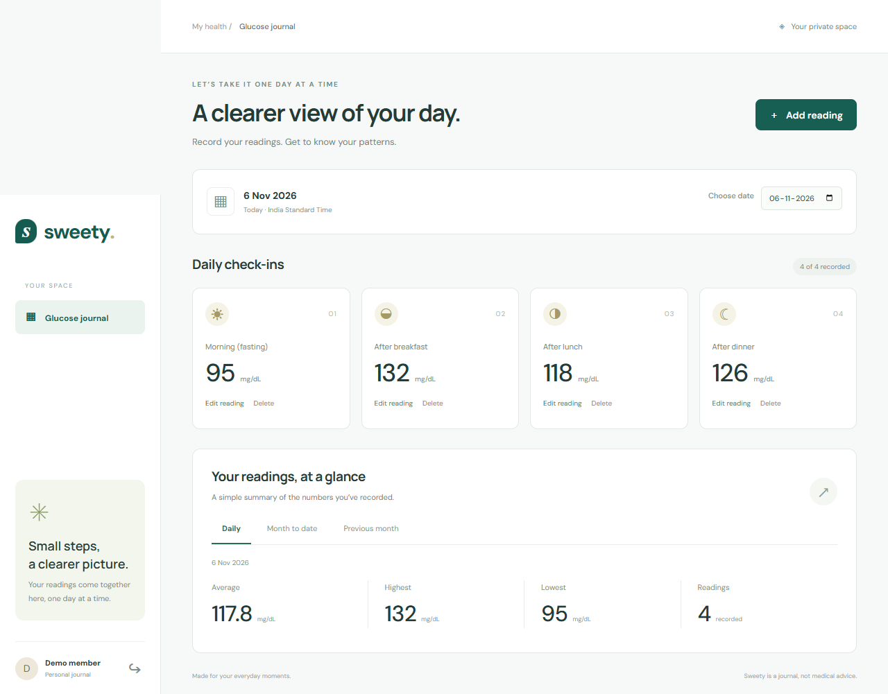

# Sweety

A calm, personal blood glucose journal built with **React, Express and PostgreSQL**. Record four daily check-ins and explore daily, month-to-date and previous-month summaries.

## Quick start

Tested with Node.js 24, npm 11 and PostgreSQL 17. Use Node.js 24 LTS and Docker with Compose, or an existing PostgreSQL database.

1. Clone the repository and open its root directory.
2. Run `npm ci` to install the versions recorded in the lockfile.
3. Copy `.env.example` to `.env` (`Copy-Item .env.example .env` in PowerShell, or `cp .env.example .env` on macOS/Linux).
4. Replace `JWT_SECRET` with a random value of at least 32 characters. You can generate one with `node -e "console.log(require('node:crypto').randomBytes(32).toString('hex'))"`. Choose a local `DEMO_PASSWORD` of at least 8 characters. Keep `.env` private.
5. Run `docker compose up -d db`. Wait for `docker compose ps` to show the database as healthy. The supplied database credentials are for local development only, and the published port binds to localhost.
6. Run `npm run db:migrate`, then `npm run db:seed`.
7. Run `npm run dev` and open **http://127.0.0.1:5173**.

Sign in with the `DEMO_EMAIL` and `DEMO_PASSWORD` from your `.env`, or create a new account. All seed readings are fictional. Seeding is repeatable: it refreshes the demo password and inserts missing sample slots without overwriting readings you edited.

If using an existing PostgreSQL installation, create an empty database and set `DATABASE_URL` to its connection string instead of starting Docker. The database user needs permission to create tables, indexes, functions and triggers. Tests also create and remove a temporary schema.

## Run and verify

| Command | Purpose |
| --- | --- |
| `npm run dev` | Run API and client together with automatic reload |
| `npm run dev -w server` | Run Express at http://127.0.0.1:3001 |
| `npm run dev -w client` | Run Vite at http://127.0.0.1:5173 with an API proxy |
| `npm test` | Run domain, PostgreSQL API and React component tests |
| `npm run test:server` | Run only domain and API tests |
| `npm run test:client` | Run React Testing Library component tests |
| `npm run build` | Compile the production client to `client/dist` |
| `npm run db:migrate` | Apply the repeatable initial database schema |
| `npm run db:seed` | Create the demo account and sample readings |
| `docker compose stop db` | Stop the local database while preserving data |

Start the database before running tests. Tests use a unique `sweety_test_<process id>` schema and remove that schema afterwards; they never truncate your app tables. Use a development database for tests. The API tests cover password hashing, login, private reads/reports, forbidden edits/deletes, validation, edit conflicts, concurrent writes, database constraints and report updates. Domain tests cover calendar boundaries, leap years, averages and empty periods.

`npm ci` reproduces dependencies from the lockfile. `-w server` or `-w client` selects an npm workspace. The migration and seed commands are safe to rerun as described above. `npm test` fails with a nonzero exit code if any assertion or database setup fails; a passing run reports zero failures. The build verifies compilation, while browser testing verifies the actual user experience. See [verification evidence](docs/VERIFICATION.md).

## Design

- The API validates every write and derives the user ID exclusively from a signed, HttpOnly session cookie. Every reading query includes that user ID. Database queries use parameters rather than interpolating user input.
- Passwords use bcrypt with cost 12. Sessions expire after seven days. Cookies use SameSite Strict and become Secure when `NODE_ENV=production`; no token is placed in browser storage.
- PostgreSQL stores calendar dates, integer glucose values and the four exact slot names. A unique `(user_id, reading_date, slot)` key prevents concurrent duplicates. Because there are exactly four valid slots, that same key also guarantees at most four readings per user per day. A database trigger rejects future dates on inserts and edits.
- All calendar days use **India Standard Time** consistently in the UI, API and database trigger. This is an explicit assignment assumption; accounts do not yet have individual time zones.
- The daily report covers the selected day. Month to date covers the first of the selected month through that day. Previous month covers the entire prior calendar month, including December/January and leap-year boundaries. Averages display one decimal. No readings means an empty state, not a zero glucose value.
- The client fetches all three summaries together, cancels obsolete date requests, and refreshes after successful mutations. Native modal dialogs provide keyboard focus management and Escape support.

### API

All routes are under `/api`. Authenticated routes require the session cookie. Write bodies are JSON objects; reading bodies are `{ "date": "2026-01-15", "slot": "After lunch", "value": 110 }`.

| Method and path | Behavior |
| --- | --- |
| `POST /auth/register` | Register `{name,email,password}` and sign in |
| `POST /auth/login` | Sign in with `{email,password}` |
| `POST /auth/logout` | Clear the session cookie |
| `GET /auth/me` | Return the signed-in profile and today's date |
| `GET /readings?date=YYYY-MM-DD` | List your readings for a day |
| `POST /readings` | Create a reading |
| `PUT /readings/:id` | Replace your reading's date, slot and value |
| `DELETE /readings/:id` | Delete your reading |
| `GET /reports?date=YYYY-MM-DD` | Return all three summaries and daily readings |
| `GET /health` | Check API/database connectivity |

Invalid input returns 400, missing authentication 401, missing or inaccessible readings 404, and conflicting readings 409. A failed write never updates the UI as if it succeeded.

## Notes and improvements

Required features are implemented. Bonuses include PostgreSQL setup through `docker-compose.yml`, a line chart of actual readings with an accessible data table, and React Testing Library form tests. See the [official requirement audit](docs/ASSESSMENT-CHECKLIST.md). The app intentionally avoids medical interpretation, target ranges and treatment recommendations. A reading is a journal entry, not clinical guidance.

With more time: add per-account time zones, broader frontend regression tests, sign-in rate limiting, password recovery, session revocation, and a paginated historical view. A production deployment also needs HTTPS, a same-origin reverse proxy for the compiled client and API, managed secrets, backups, monitoring and restrictive database access. The supplied scripts target local assessment review, and the API binds to localhost. Google Fonts improve typography when online; system fonts remain available offline.

This project was developed with OpenAI Codex assistance. Glen should review the code and use the [engineering walkthrough](docs/WALKTHROUGH.md) to explain the design and tradeoffs accurately. AI assistance is disclosed rather than represented as unaided work.

## Agent collaboration

`AGENTS.md` contains shared working rules. `CLAUDE.md` imports those rules for Claude compatibility. [HANDOFF.md](HANDOFF.md) holds the current state and separate Codex/Claude update sections. Both agents need access to the same checkout, or must exchange committed updates. One agent owns implementation at a time; the other can review. The handoff file does not automatically transmit messages. The local, ignored `SDD.md` remains Codex's architectural reference.
